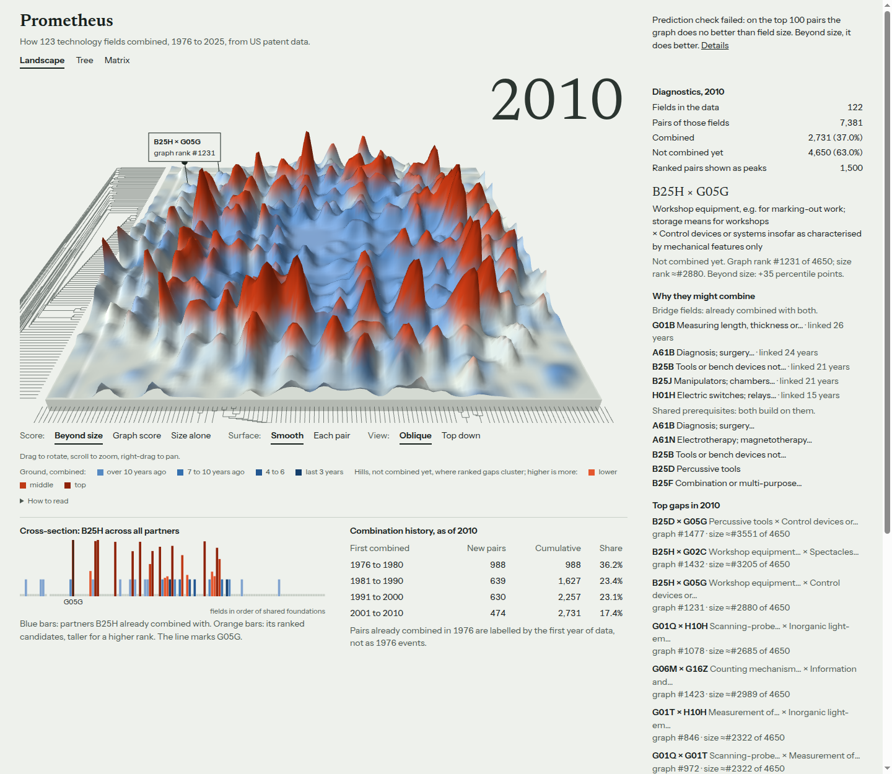
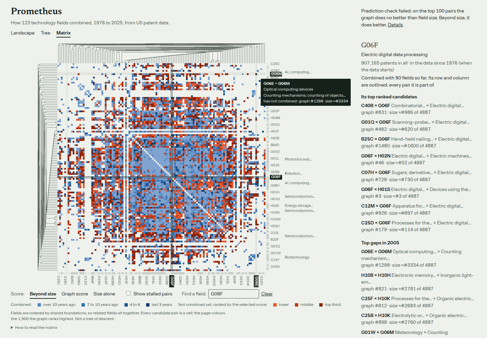

# PROMETHEUS

A technology graph built from patents, kept in one [Relate](https://relatedb.ai) file. It shows how technology
fields combined over time, predicts which combinations come next, and **grades its own predictions against
history**. Built for the Relate by Neo4j hackathon.

- **Field**: a CPC subclass (for example `H01M`, batteries). It exists from the first year it has enough patents.
- **Combined**: two fields are combined once enough patents carry both classes.
- **Builds on**: one field builds on another once enough of its patents cite the other's.
- **Time travel**: every edge stores the year it first appeared, so "the graph as of 1995" is a filter, not a copy.
- **Backtest**: pick a cutoff year, rank the pairs that had not combined yet, and check which ones did in the next ten years.
- **Sealed time capsules**: one small read-only Relate file per year, with field names hidden, so a forecaster (a language
  model over MCP, or the built-in predictor) sees only what was known then and is graded on what happened.

## Use case

**The problem.** New technology often arrives where two existing fields meet: batteries and software, imaging and machine learning. People who plan research
or follow innovation (R&D strategists, funders, analysts) would like to know which pairs of fields are about to combine. Anyone can claim to see it; very
few check the claim against history. And there is a cheap rival that is easy to forget: **big fields tend to combine with other big fields**, so a "prediction"
may only be a measure of size. This project builds the graph that lets you ask the question properly, and grades the answer against what actually happened.

**Which relationships matter.** Everything is a relationship between technology fields (patent classes), and each one carries the year it first appeared:

| Relationship | Meaning | Why it matters |
|---|---|---|
| `COMBINED_WITH` | enough patents carry both classes | the thing being predicted; its history is the training signal |
| `BUILDS_ON` | one field's patents cite the other's | a field's prerequisites; fields with shared foundations are close |
| shared partners and shared prerequisites | two fields that have not combined yet, but already connect to the same fields | the evidence for a candidate pair, shown on every page as "bridge fields" and "shared prerequisites" |
| `CO_CLASSIFIED` | some patents carry both classes, below the combination threshold | pairs that are stalled, not absent |
| time (`firstYear` on every edge) | when a relationship appeared | the graph "as of" any year is a query, so every prediction can be tested on what came after |

**Who it is for.** A person exploring the graph (a tree, a matrix and a 3D landscape, each with the evidence behind a pair), and an agent that has to reason over it:
the forecaster experiments give a language model only a sealed, blinded, read-only Relate file for one year and score its ten picks against the next ten years.

**What we found.** Not what we hoped. On the question we declared in advance, the graph's predictions do **not** beat the size rule (a clear NO-GO). Where we looked beyond
size, afterwards and labelled as exploratory, the graph does carry real information. The honest answer to "which fields will combine next?" is therefore
"big ones, mostly; the graph adds something real among the rest". See [What we found](#what-we-found-real-patentsview-data-945-million-us-patents-1976-to-2025).

It is a way to examine a claim, not a forecast to invest on: a high rank is a ranking, not a probability.

## What we found (real PatentsView data, 9.45 million US patents, 1976 to 2025)

**1. The pre-registered test failed.** Before looking at any result we fixed the rule: the hybrid predictor's lift@100 on the
held-out years (2005, 2010, 2014) must reach about 2 times the better of random and preferential attachment (PA, "big fields
combine with big fields"). It got **4.44 against 4.26, a ratio of 1.04: NO-GO**, and the sensitivity runs agree (ratio 1.04 to
1.08 on `--slice all` and at pair thresholds 2 and 5). The graph signals do predict (AUC about 0.84 against 0.50 for random), but
the test cannot show more than PA. The reason is a ceiling at the top of the ranking:

| Held-out cutoff | Positives | Base rate | Max possible lift@100 | PA lift@100 | Hybrid lift@100 | PA AUC | Hybrid AUC |
|---|---|---|---|---|---|---|---|
| 2005 | 660 | 0.135 | 7.40 | 5.04 | 5.63 | 0.777 | 0.843 |
| 2010 | 1,050 | 0.226 | 4.43 | 4.03 | 4.12 | 0.808 | 0.853 |
| 2014 | 1,046 | 0.240 | 4.17 | 3.71 | 3.59 | 0.829 | 0.864 |

By 2010 PA already reaches 91% of the best lift that is mathematically possible, so no method can look much better at the top.
The headline gate measured the one place where the methods are indistinguishable.

**2. Exploratory findings (defined after seeing the NO-GO; not pre-registered).**
- **A2, beyond size.** On the pairs PA ranks in the *bottom* half, the hybrid (weights frozen from 1990 to 2000) has AUC 0.82 to
  0.86, and beats PA on those same pairs by +0.23, +0.17 and +0.09 AUC at 2005, 2010 and 2014 (95% paired bootstrap intervals
  +0.18 to +0.28, +0.13 to +0.20, +0.06 to +0.12). The advantage is real but shrinks with each later cutoff. It also holds with patent counts as the size proxy and on a narrowed slice (see A2b below).
- **A4, forecaster beyond size.** Fresh language-model agents, using only Relate's read-only MCP query tools on sealed,
  blinded capsules, forecast ten pairs each for 1995, 2005 and 2010 among the pairs PA does not rank as easy. They hit **9 of 30**
  against 1.5 expected by chance (about six times), and about the same as the graph predictor (10 of 30). Roughly double the
  size-only control (4 of 30) is suggestive, not established (Fisher p = 0.21).

**3. Caveats that matter.**
- A2 and A4 were designed after A3 (a first forecaster experiment) saturated and after the NO-GO, so they are exploratory;
  A3 is reported in full beside them. A4's eligibility rule was written down before any A4 agent ran.
- PA is one size proxy, not all of size. Bootstrap intervals treat pairs as independent; they share fields, so the real
  uncertainty is wider. A4 is 30 pairs from three capsules with overlapping picks.
- Blinding reduces but cannot prove the absence of hindsight; the agents are the same model family as the author's session.
- 109 of 123 fields were already present in 1976, the first year of data, so field ages are left-censored and the lineage tree
  is nearly flat. Field labels use today's CPC on old patents. See [Limitations](#limitations).

**What exists:** pipeline, store, queries, predictor, backtest, genome vectors, sealed capsules, grading, a local web page
(circular tree of fields recomputed per year, with arcs, a year slider, dependencies, knock-out and stalled-pair overlays, an evidence panel and the prediction check), and 63 tests. **Not done:** OpenAlex paper-side edges (skipped on purpose).

## Try it in two minutes (no download)

```bash
pip install -e ".[dev]"     # Python 3.10+
make demo                   # generates a SYNTHETIC toy graph and runs everything on it
make test
```

`make demo` writes the toy data, builds `data/toy.rl`, stores genome vectors, runs the backtest
(`results/toy/backtest.md`, with a synthetic-data banner), builds sealed capsules for 1995 and 2005, writes a forecast from
the graph predictor, and grades it against the 2005 capsule.

## Run it on real patents

1. Download the PatentsView tables listed in [docs/DATA.md](docs/DATA.md) (several GB; the page has moved, see the note there).
2. Build the small field-level files, then the store:

```bash
prometheus pipeline --patent data/raw/g_patent.tsv --cpc data/raw/g_cpc_current.tsv \
                  --cites data/raw/g_us_patent_citation.tsv --titles data/raw/g_cpc_title.tsv \
                  --out data/csv --slice deeptech --memory-limit 8GB --temp-dir /path/with/free/disk
prometheus build data/csv data/prometheus.rl
prometheus genome data/prometheus.rl
prometheus backtest data/prometheus.rl --out results
```

The pipeline also writes `co_assigned.csv` (the first year a patent carried both classes of a pair, for the stalled-pair overlay) and `field_year.csv` (patents per field per year, for the patent-count size proxy). The pipeline reads column names from the file headers. If one differs from what is expected, it stops and prints the
columns it found.

## How Relate is used, and why

**Storage mode: a single `.rl` file** (`data/prometheus.rl`), plus one small `.rl` per year in `capsules/`. A judge can
open any of them with the Relate CLI or the Python package, no server needed. A single file is the right fit because the
store is written once by a pipeline and then only read; one file is easy to ship, inspect and diff by size, and a capsule
is naturally "one file per moment in time". The persistent data lives in `data/` and `capsules/`.

**What the graph models**

| Element | Properties | Meaning |
|---|---|---|
| `(:Field)` | `code`, `title`, `firstYear`, `nPatents`, `genome` | a CPC subclass; `genome` is a vector with a vector index |
| `[:COMBINED_WITH]` | `firstYear`, `count` | two fields share patents (stored once, queried undirected) |
| `[:BUILDS_ON]` | `firstYear`, `count` | the first field's patents cite the second's |
| `(:Meta)` | `source`, `dataEndYear`, `slice`, thresholds | where this store came from |

`count` is a total through the end of the data. It is for display only: predictors and capsules use existence and
`firstYear`, because a total would leak the future.

**Where Relate does the work**

| Feature | Relate capability | File |
|---|---|---|
| Any snapshot of history | Cypher filter on edge properties | `queries/fields_as_of.cypher` |
| Gaps (adjacent possible) | multi-hop Cypher with a time-aware `NOT EXISTS` | `queries/gaps_common_neighbours.cypher` |
| Bridge fields for a gap | two-hop Cypher | `queries/bridge_fields.cypher` |
| Ancestry | one 1-hop query per level (avoids path explosion) | `queries/ancestors_step.cypher` |
| Knock-out cascade | Cypher aggregation over a parameter map | `queries/knockout_step.cypher` |
| Nearest relatives | vector property and vector index | `prometheus relatives` |
| Sealed capsules | one single-file store per year, served read-only over MCP | `prometheus capsule` |

A test checks that the Cypher common-neighbour query and the in-memory scorer agree on every pair, and every file in
`queries/` is executed by the test suite.

## The commands

```
prometheus toy | pipeline | build | info          make or load data
prometheus gaps STORE --as-of 2000                top predicted combinations as of a year
prometheus evidence STORE A B --as-of 2000        bridge fields and shared prerequisites for a pair
prometheus ancestors | descendants STORE CODE     what a field builds on / what builds on it
prometheus knockout STORE CODE [--as-of Y]        dependency exposure if a field were removed
prometheus breakthrough STORE A B --as-of Y       what the model would score if a pair combined (read-only)
prometheus backtest STORE                         grade the predictor, write results/backtest.md
prometheus genome | relatives | order             genome vectors, nearest relatives, dendrogram order
prometheus capsule | baseline-forecast | grade    sealed capsules and grading
prometheus serve STORE                            local read-only web page: heatmap, year slider, evidence
prometheus beyond STORE --weights-from F          A2: AUC on pairs preferential attachment ranks in the bottom half
prometheus pa-threshold CAPSULE [--write-brief F]  A4: eligibility threshold (and brief) for a capsule
```

## Explore it (the tree of life)

```bash
prometheus serve data/prometheus.rl --weights-from results/backtest.json --open     # http://127.0.0.1:8765/
```

A local page (standard-library server, D3 and fonts bundled so it works offline, no build step) over the store, opened
read-only. The 123 fields sit around a circle, grouped by how similar their foundations are (genome clustering of the "builds
on" graph; it is **not** a tree of descent). Pairs that already combined are bundled arcs through the middle, shaded by age at
the slider year, so the picture builds up as the slider moves. Pairs that have not combined but rank high are dashed fire-coloured
arcs; fire means a predicted pair and nothing else. The prediction check, including the failed gate, is always on the page.

| Control | What it does |
|---|---|
| Year slider and Play | the graph as of that year; ticks mark the backtest cutoffs 2005, 2010, 2014. The tree is **recomputed for each year** from the fields in the data that year, each branch flipped to stay near last year's position (consecutive years move a leaf 6 of 123 positions on average); fields not yet in the data wait in a gap at the end of the circle. `#tree=fixed` keeps the single all-data tree |
| Combinations | arcs of combined pairs and the top gaps; click a field or a dashed arc for evidence (bridge fields, shared prerequisites) |
| Dependencies | what the selected field builds on and what builds on it |
| What breaks | leaves shaded by how exposed they are if the selected field disappeared, with the number of citing links behind each |
| Score: Beyond size, Graph score, Size alone | how the gaps are ranked; Beyond size is graph rank minus what field size alone predicts |
| Show what happened | up to 2014: gaps that combined within ten years are solid, the rest hollow grey |
| Show stalled pairs | grey dotted arcs for pairs where some patents carry both classes, for three years or more, but fewer than the 3-patent combination threshold (about 800 a year). A display overlay: it is not a score and not a prediction |
| Details (top right) | the per-cutoff backtest table and a chart of graph vs size alone, all pairs and beyond-size |

**Landscape view (3D).** The `Landscape` link in the top bar opens `/landscape` (WebGL, Three.js bundled, so it works offline): the matrix as terrain.
Every point on the surface is a pair of fields, in the same genome order as the matrix, with the clustering tree along the front and left
edges. The low ground is pairs that already combined, shaded blue by age; fire-coloured peaks are ranked gaps. Two honest settings:
**Smooth** (default) blurs the surface over about two neighbouring fields, so a hill means many high-ranked gaps among related fields and
heights are relative to the tallest hill that year; **Each pair** draws every ranked pair as its own spike, taller for a higher rank. Drag to
rotate, scroll to zoom, right-drag to pan; hover and click snap to the nearest ranked pair. **Reading it:** field codes run along the two near edges (every sixth field) and domain
names along the two far ones, de-cluttered so they never overlap; the top ranked hills carry labels you can click; hovering a point lights its row and column across the terrain and
marks both fields on the edges; **Find a field** (type `G06F`) draws that field's row and column and shows its own cross-section and top candidates; selecting a pair or a field moves
the camera gently to it; **Oblique, Low angle, Top down** and **Reset** set the view; a small scale in the corner says what height means for the current surface setting. A cross-section panel is a stacked area chart of the selected field
against every other field (smoothed like the surface, or stepped on Each pair): the share of nearby fields it has combined with, by age, and that are ranked candidates, by rank third. It uses true values, not the blur; and a table shows how many pairs first combined in each period up to the slider year. If the
browser has no WebGL the page says so and still lists the numbers and the top gaps. It is a ranking, not a probability, like every other view.



**Matrix view.** The `Matrix` link in the top bar opens `/matrix`, the same year slider, score toggle and evidence panel on a
grid of every field pair, ordered by shared foundations with the clustering tree on both edges. Blue cells already combined (darker is
newer); fire cells are the 1,500 pairs the graph ranks highest. The tree shows about 25 arcs; the matrix shows where size and the
graph disagree across all of them, so it carries the beyond-size finding more honestly. `Tree` goes back, keeping the year. The tree stays the front page.

Deep links: `#year=1998`, `#year=2005&stalled=1`, `#tree=fixed`, `#year=2005&gap=1`, `#mode=deps&field=G06F`, `#mode=breaks&field=H01L`, `#year=2005&happened=1&gap=2&details=1`.
Screenshots at 1985, 1998 and 2010 are in `docs/screenshots/`; the design and the choices made while building it are in
`docs/DESIGN.md`. `python scripts/ui_check.py` drives all three pages in a real browser (77 checks: keyboard, clicks, 3D picking, Play, modes, offline, no-WebGL fallback).




## Grading rules (fixed before any result)

- For a cutoff year Y, the **candidates** are all pairs of fields that exist at Y and have not combined. The **positives**
  are those that first combine in (Y, Y + 10].
- Methods: random and preferential attachment are baselines; common neighbours, Adamic-Adar, shared prerequisites and genome
  similarity are signals; the **hybrid** mixes them. Metrics: AUC, precision@100 and lift@100 (precision divided by the
  share of candidates that are positive).
- Weights are tuned on the cutoffs 1990, 1995 and 2000 only. Results that count are on 2005, 2010 and 2014. Every
  cutoff is reported with its number of positives, and fewer than 30 positives is labelled low-confidence.
- **Gate:** the hybrid's lift@100 on the held-out cutoffs must reach about 2 times the better of the two baselines. The 2 is a
  judgment call, not derived from data. The gate uses the hybrid, declared in advance, rather than the best method on the
  test years, which would inflate the result.
- The harness is itself tested: on toy data with planted structure it says GO, and on a placebo with no structure it says
  NO-GO (`tests/test_predict_backtest.py`). If the placebo ever said GO, the harness would be inventing skill.

All settings are in `src/prometheus/config.py`. Change them before looking at results, not after.

## The field slice

`--slice deeptech` keeps only fields in chosen CPC classes (AI and computing, semiconductors, biotechnology, medical devices,
energy storage and power, robotics, photonics and sensing) and drops the cross-sectional Y tagging classes
(`src/prometheus/slices/deeptech.json`). It is chosen by **class prefix written down in advance**, never by which fields grew
fast, because choosing the winners would leak the answer into the backtest. Check the prefixes against the CPC titles and edit
the file **before** the first backtest. Fields are subclasses, so a topic that lives inside a larger subclass (as far as I
know, quantum computing is one) cannot be isolated. Run the backtest on `--slice all` too and compare.

## Sealed capsules and the forecaster

```bash
prometheus capsule data/csv --as-of 1995 --out capsules/1995.rl --seed 0
prometheus capsule data/csv --as-of 2005 --out capsules/2005.rl --seed 0
```

A capsule holds only fields and edges with `firstYear` up to its year, with codes and titles replaced by opaque ids
(`F0001`), no counts and no predictions. The id-to-code table is written next to it (`1995.map.json`), never inside it. Ids
are stable across capsules built with the same seed, so a forecast on 1995 can be graded against 2005.

To run a language-model forecaster, install the Relate CLI (`curl -sSfL https://relatedb.ai/install.sh | bash`), add the
generated `capsules/1995.mcp.json` to your MCP client, give the agent `capsules/1995.brief.md`, save its answer as
`forecast.json`, then:

```bash
prometheus grade forecast.json --against capsules/2005.rl --as-of 1995
```

The grader rejects pairs that are unknown or already combined, counts how many forecasts came with their Cypher, and compares the
forecaster with random, preferential attachment and the graph predictor on the same candidate pairs.
**Limits:** blinding reduces hindsight leakage but cannot prove it is zero, because a model might recognise the shape of the
graph; and ten forecasts is a small sample. Treat the agent result as an experiment. The graph predictor has no such leak and is
the headline number. The MCP server was smoke-tested on the **toy** capsule on 2026-11-13 (Relate CLI v1.0.1, `relate serve --mcp stdio --read-only`): it exposes `read_cypher` and `get_schema`, runs MATCH queries, and rejects writes ("Only MATCH queries are allowed"). A forecaster (Claude in a coding session, using only queries against the 1995 capsule) returned ten pairs with Cypher and the grader accepted all ten. They scored 0 of 10 hits against 59 positives among 6,171 candidates, which on synthetic data and ten forecasts means nothing. The real-capsule experiment (A3) has since been run; see its result under Pre-declared analyses. It used a read-only Cypher helper over the same `relate serve --mcp stdio` server, not an MCP-native client.

## Real-data results

PatentsView release dated 2026-02, 9.45M patents. Held-out cutoffs 2005, 2010, 2014. Settings were not changed after seeing results.

| Run | Fields | Hybrid lift@100 | Best baseline | Ratio | Gate (2.0) |
|---|---|---|---|---|---|
| deeptech, pair threshold 3 (main) | 123 | 4.44 | 4.26 | 1.04 | NO-GO |
| deeptech, pair threshold 2 | 123 | 4.27 | 4.02 | 1.06 | NO-GO |
| deeptech, pair threshold 5 | 123 | 4.79 | 4.44 | 1.08 | NO-GO |
| all fields, pair threshold 3 | 635 | 8.73 | 8.43 | 1.04 | NO-GO |
| narrowed deeptech (`G10L`, `B25J`), pair threshold 3 | 110 | 3.74 | 3.52 | 1.06 | NO-GO |

The graph signals have real skill (AUC about 0.84 against 0.50 for random), but preferential attachment (big fields combine with big fields) already gets most of it, so the hybrid does not clear the declared gate. The genome vector is weak (AUC 0.54 to 0.70). Per-cutoff numbers for the main run are in [What we found](#what-we-found-real-patentsview-data-945-million-us-patents-1976-to-2025); full tables for every method and run are in `results/`.

## Pre-declared analyses

Written on 13 Nov 2026. This section is fixed before the forecaster experiment (A3) or the beyond-size analysis (A2)
was run; A1 had already been run when it was written, as the Real-data results table shows. If anything here changes later, the change is dated below
and the original text stays.

- **A1, sensitivity.** `--slice all`, and `--min-pair-patents 2` and `5` on deeptech. Reported next to the main run. The
  headline verdict stays deeptech with a minimum of 3. *(Already run before this section was written.)*
- **A2, beyond size (exploratory).** Defined after seeing the NO-GO, so it is exploratory. At each held-out cutoff (2005,
  2010, 2014), keep only the candidate pairs that preferential attachment ranks in the bottom half, and report the hybrid's
  AUC on that subset. There is no pass/fail threshold.
- **A3, forecaster experiment.** Three capsules (1995, 2005, 2010), ten pairs each, one fresh agent run per capsule, graded
  against the capsule ten years later (2005, 2015, 2020). Report total hits with random-expected, preferential attachment
  and the graph predictor on the same candidates. If the grader rejects pairs, only those are replaced, and that is stated.
  A base rate near 24% means random already gets about 2 to 3 of 10, so only a large gap over random or preferential
  attachment counts as a finding; otherwise it is reported as an experiment with no conclusion.

### Running A3

Each run gets its own folder outside the repo, holding only that capsule, its brief and an MCP config with an absolute path.
The `.map.json` files (opaque id to real CPC code) stay in `capsules/` and must never be visible to the forecaster.

```bash
prometheus capsule data/csv --as-of 1995 --out capsules/1995.rl --seed 0     # same seed so ids match; also 2005 2010 2015 2020
# one folder per forecast:  ~/prometheus-forecaster/1995/{1995.rl, BRIEF.md, mcp.json}
# start a FRESH agent there (Claude Desktop with only that mcp.json entry, or `claude --mcp-config mcp.json` in that folder)
# give it only BRIEF.md; save its JSON answer as forecast_1995.json
prometheus grade forecast_1995.json --against capsules/2005.rl --as-of 1995
prometheus grade forecast_2005.json --against capsules/2015.rl --as-of 2005
prometheus grade forecast_2010.json --against capsules/2020.rl --as-of 2010
```

The agent sees two Relate MCP tools, `get_schema` and `read_cypher`; writes are refused. The forecaster must be a fresh agent:
anything that has seen this repo or `results/backtest.md` cannot be blind.

### A2b and the narrowed slice (declared 13 Nov 2026, before either was run; both exploratory)

Both were chosen **after** the main run and its NO-GO, so they are exploratory and are reported beside the original results, never instead of them.

- **A2b, a second size proxy.** A2 used the product of two fields' number of combination partners (degree) as its size proxy. A2b uses
  **patents**: the product of the two fields' cumulative patent counts as of the cutoff year (patents granted in the slice through that year,
  from per-year counts; never the end-of-data total, which would leak the future). Same cutoffs (2005, 2010, 2014), same frozen hybrid weights
  from `results/backtest.json`, same 2,000-resample paired bootstrap. Two subsets are reported: (1) pairs in the bottom half by patent-count
  product, with the patent-count product as the reference; (2) pairs in the bottom half by **both** degree product and patent-count product,
  with both as references. No pass/fail threshold. If the hybrid's lead over the patent-count reference is not clearly above zero, the
  "beyond size" wording in this README shrinks to say so.
- **Narrowed slice.** The deeptech slice kept every subclass under the prefixes `G10` and `B25`, which pulled in musical instruments
  (`G10C` pianos, `G10D`, `G10F`, `G10G`, `G10H`) and hand tools (`B25B` to `B25H`). Both showed up among the top gaps of the main run. The narrowed
  slice (`src/prometheus/slices/deeptech_narrow.json`) is identical except `G10` becomes `G10L` (speech analysis and synthesis) and `B25`
  becomes `B25J` (manipulators and robots). It is chosen by the CPC titles, not by which fields grew; but it was prompted by results, so the
  headline stays the original `deeptech` slice with minimum pair threshold 3. Reported: the gate, the per-cutoff table and A2 with its
  own tuned weights. The original slice file is not edited.

### A2b and narrowed-slice results (run 13 Nov 2026, exploratory, declared above before running)

**A2b: a second size proxy.** `prometheus beyond data/prometheus.rl --weights-from results/backtest.json --proxy patents` (and `--proxy both`).
Same frozen weights and paired bootstrap as A2. Hybrid AUC minus the reference's AUC on the same pairs, with a 95% interval:

| Cutoff | Subset | Positives | Hybrid AUC | Reference AUC | Hybrid minus reference |
|---|---|---|---|---|---|
| 2005 | bottom half by patent counts | 143 of 2,443 | 0.843 | 0.620 | **+0.224** (+0.186 to +0.264) |
| 2010 | bottom half by patent counts | 223 of 2,325 | 0.837 | 0.665 | **+0.172** (+0.142 to +0.203) |
| 2014 | bottom half by patent counts | 194 of 2,182 | 0.836 | 0.697 | **+0.139** (+0.105 to +0.171) |
| 2005 | bottom half under both proxies | 85 of 1,964 | 0.866 | PA 0.631, patents 0.584 | +0.235 vs PA, +0.282 vs patents |
| 2010 | bottom half under both proxies | 115 of 1,875 | 0.825 | PA 0.642, patents 0.604 | +0.183 vs PA, +0.221 vs patents |
| 2014 | bottom half under both proxies | 101 of 1,759 | 0.826 | PA 0.739, patents 0.666 | +0.088 vs PA, +0.161 vs patents |

Every interval excludes zero (the smallest is +0.049, hybrid vs PA, 2014 on the intersection). By the rule declared in advance, the "beyond size" wording does not shrink:
it holds against patent counts as well as against degree. Two cautions that stay: both are crude size proxies, and the lead against PA keeps shrinking toward the later cutoffs.
Full tables: `results/beyond_size/beyond_size_patents.md` and `beyond_size_both.md`.

**Narrowed slice** (`deeptech_narrow`: `G10` becomes `G10L`, `B25` becomes `B25J`; 110 fields instead of 123, 3,725 combined pairs). Same procedure, its own tuned weights.
The gate is **NO-GO again** (hybrid lift 3.74 against 3.52, ratio 1.06), and the ceiling is the same story: by 2010 PA reaches 3.33 of a possible 3.66.
A2 on this slice: hybrid minus PA is **+0.232** (+0.184 to +0.281) at 2005, **+0.186** (+0.149 to +0.223) at 2010 and **+0.100** (+0.071 to +0.132) at 2014.
So removing the musical instruments and hand tools changes neither the verdict nor the beyond-size finding. Tables: `results/narrow/`.

### A3 result (run 13 Nov 2026)

Three fresh subagents (same model family as the author's session, no repo or backtest context, instructed to stay in their
folder; their tool calls were audited afterwards and all stayed inside it), one per capsule, each making 4 or 5 read-only
Cypher calls through the Relate query path. The grader accepted all 30 pairs, each with its Cypher, so none were replaced.
Forecasts and grades are in `results/forecaster/`.

| Forecast year | Graded against | Positives / candidates | Forecaster | Pref. attachment | Graph predictor | Random expected |
|---|---|---|---|---|---|---|
| 1995 | 2005 capsule | 536 / 5,201 | 6 / 10 | 8 / 10 | 8 / 10 | 1.0 |
| 2005 | 2015 capsule | 660 / 4,887 | 10 / 10 | 10 / 10 | 10 / 10 | 1.4 |
| 2010 | 2020 capsule | 1,050 / 4,650 | 10 / 10 | 10 / 10 | 10 / 10 | 2.3 |
| **Total** | | | **26 / 30** | **28 / 30** | **28 / 30** | **4.6** |

**Reading it.** This test **cannot separate the methods**. In 2005 and 2010 all three scored 10 of 10: the ten
highest-ranked pairs by almost any sensible ranking combine within ten years, so the test is saturated. The 1995 gap (6 vs 8
of 10) is well within noise at n = 10, and 26 vs 28 of 30 is not a difference. It is **not** a loss to preferential
attachment, and it is not evidence that the graph predictor is better either. What it does show: agents can use Relate's
read-only MCP tools to build a graph argument with Cypher evidence for each pair (all 30 pairs came with a query the grader
accepted), and they converge on a size-driven heuristic (shared combination partners among well-connected fields) by
themselves. Whether that convergence was hinted by the brief or the spawning prompt can be checked: the exact prompts, the
briefs and the helper are in `results/forecaster/PROMPTS.md`. Blinding cannot prove there was no hindsight. It is three runs
of ten pairs: an experiment, with no claim of foresight.

### A2 result: beyond size (run 13 Nov 2026, exploratory)

`prometheus beyond data/prometheus.rl --weights-from results/backtest.json`. Candidates are the pairs that preferential
attachment ranks in the bottom half; hybrid weights are the ones tuned on 1990/1995/2000 and never refitted; hybrid
percentiles are taken over all candidates. AUC with a 95% bootstrap interval over pairs (2,000 resamples). Pairs share fields,
so the intervals are narrower than the true uncertainty. Full tables: `results/beyond_size/beyond_size.md`.

| Cutoff | Positives in subset | Hybrid | cn | aa | prereq | genome | PA (reference) | Random |
|---|---|---|---|---|---|---|---|---|
| 2005 | 113 of 2,443 | **0.857** (0.826 to 0.884) | 0.802 | 0.824 | 0.671 | 0.691 | 0.628 | 0.508 |
| 2010 | 171 of 2,325 | **0.821** (0.791 to 0.851) | 0.748 | 0.770 | 0.694 | 0.633 | 0.657 | 0.518 |
| 2014 | 155 of 2,182 | **0.820** (0.790 to 0.851) | 0.780 | 0.796 | 0.732 | 0.611 | 0.734 | 0.499 |

Paired difference, hybrid AUC minus PA AUC on the same pairs (same bootstrap resamples, 95% interval): **+0.229 (+0.184 to +0.276)** at 2005, **+0.165 (+0.130 to +0.199)** at 2010, **+0.086 (+0.057 to +0.117)** at 2014. Each single signal against PA is in `results/beyond_size/beyond_size.md`; common neighbours and Adamic-Adar are above PA at all three cutoffs, prerequisites and the genome are not reliably.

**Reading it.** Splitting at the median still leaves size variation inside the half, so the comparison that matters is not the hybrid's AUC alone but its AUC against PA's on the same pairs. PA scores only 0.63 to 0.73 there, and the paired difference is clearly above zero at every cutoff, so "beyond size" holds for this proxy. The advantage shrinks from 0.23 to 0.09 as the cutoff moves later. Once the hub-meets-hub pairs are set aside, the graph signals are clearly above chance (interval lower bounds
0.79 to 0.83). Together with the main backtest this sharpens the NO-GO
story: the gate measures lift@100, the top of the ranking, where the easy hub pairs make every method look the same
(saturated, as in A3); lower in the ranking the graph does add information that field size does not. The NO-GO verdict is
unchanged, because the gate was declared first. Two cautions: PA (degree product) is one proxy for size, not all of it, and
the hybrid's win over PA shrinks at 2014 (0.820 vs 0.734). On the placebo and structured toy data the same harness returns
0.5 and above 0.5 respectively (`tests/test_beyond.py`), so it does not invent skill.

### A4: forecaster beyond size (declared 13 Nov 2026, before any A4 run; exploratory)

A4 was **designed after A3 came back saturated and after A2**, so it is exploratory and carries no pre-registration beyond
its own rule. Because A2 is clearly above 0.5, the forecaster experiment is repeated on a candidate set where saturation is
removed. Its eligibility rule and grading were fixed before any A4 forecast was made or any A4 brief was shown to an agent:

- **Candidate set.** Per capsule, pairs not yet combined with deg(a) * deg(b) <= T, where deg is the number of
  `COMBINED_WITH` partners in the capsule and T is the lower median of that product over all candidate pairs
  (`prometheus pa-threshold`). A fixed number, not a tie-broken rank, so the agent can verify eligibility itself.
  T = 450 (1995 capsule; 2,614 eligible of 5,201), 738 (2005; 2,449 of 4,887), 945 (2010; 2,332 of 4,650).
- **Agents.** Fresh agents, one per capsule (1995, 2005, 2010), ten pairs each, graded against the capsule ten years later
  (2005, 2015, 2020). The brief is the A3 brief plus one paragraph stating the eligibility rule (`prometheus pa-threshold
  --write-brief`); the spawning prompt is the A3 prompt, unchanged apart from paths. The exact text is saved in
  `results/forecaster_a4/` before the agents run.
- **Grading.** `prometheus grade ... --pa-max T --weights-from results/backtest.json`: only eligible pairs are candidates, and the
  graph predictor uses the frozen weights (genome included) over the same candidates. Reported: forecaster hits, random
  expected on the eligible set, the graph predictor's top ten, and PA's top ten within the eligible set (a reference only).
  Ineligible pairs are rejected and only those are replaced, with the replacement stated.
- **No pass/fail.** The base rate in the eligible set is roughly 5 to 7%, so random expects well under one hit in ten.
  Only a clear gap over random counts; anything else is reported as an experiment with no conclusion.

### A4 result (run 13 Nov 2026)

Declaration above, unchanged. Three fresh agents, one per capsule, ten pairs each. The grader accepted all 30 pairs (none
ineligible, none replaced), and the eligible candidate sets match the A2 subsets. The exact prompts and briefs are in
`results/forecaster_a4/`; each agent made three tool calls, all inside its own folder (audited afterwards).

| Forecast year | Graded against | Eligible pairs, positives (base rate) | Forecaster | Graph predictor (frozen weights) | PA, top 10 eligible | Random expected |
|---|---|---|---|---|---|---|
| 1995 | 2005 capsule | 2,614, 83 (3.2%) | 3 / 10 | 2 / 10 | 1 / 10 | 0.3 |
| 2005 | 2015 capsule | 2,449, 113 (4.6%) | 3 / 10 | 4 / 10 | 2 / 10 | 0.5 |
| 2010 | 2020 capsule | 2,332, 172 (7.4%) | 3 / 10 | 4 / 10 | 1 / 10 | 0.7 |
| **Total** | | | **9 / 30** | **10 / 30** | **4 / 30** | **1.5** |

**Reading it.** Unlike A3, this test is not saturated, and it separates the methods from chance. With the easy hub pairs
removed, the agents' forecasts scored about six times what random guessing is expected to (9 vs 1.5 of 30), matched the graph
predictor (9 vs 10, not a difference at this size), and beat the control that simply takes the biggest eligible pairs (4 of 30).
That control matters: the agents again ranked by shared combination partners and in 1995 and 2005 put 9 of 10 picks at 80% or
more of the threshold, so they chose the largest pairs the rule allowed. Against that control the forecaster is roughly double (9 vs 4 of 30) and the graph predictor 10 vs 4, but this is suggestive,
not established: two-sided Fisher exact p = 0.21 (forecaster vs PA) and 0.13 (graph predictor vs PA), and forecaster vs graph
predictor is 9 vs 10 (p = 1.0). The solid claims are about six times chance, and the agent matching the graph predictor. The
direction agrees with A2. Caveats: 30 pairs from three capsules is small and the
counts are not independent (the 2005 and 2010 lists share 4 pairs, 1995 and 2005 share 3); the A3 and A4 agents and this
analysis share a model family; blinding cannot prove there was no hindsight. A forecaster that explicitly ranks by something
other than common neighbours was not tested.

## Limitations

- **Left-censored field ages.** On the real data 109 of 123 deeptech fields have `firstYear` 1976, simply the first year in
  PatentsView. Their real birth is unknown. The lineage tree (a parent must be strictly older) therefore places only 14 fields,
  and the early part of the year slider is mostly 1976. The page says so on the Lineage tab. Any redefinition of the lineage
  rule (for example ranking ties by how built-upon a field is) is a modelling change and would be dated here.

- A pair counts as combined once its cumulative count reaches 3, so labels move if that moves. Re-run the pipeline with
  `--min-pair-patents 2` and `5` and report both.
- PatentsView's current CPC table carries today's classification for old patents, so the early field map reflects hindsight
  in how patents were labelled. Not yet checked against the data dictionary.
- Citations are attributed to each patent's primary class (lowest sequence among inventive classes), a deliberate simplification.
- Pairs of two huge fields look easy to predict and say little. Look at the results with the busiest fields removed.
- The knock-out is a dependency measure along citations, not proof of cause. The breakthrough view shows what the *model* would
  score, not what would happen.
- Scale: on a synthetic 1-million-patent dataset (2.5 million class rows, 4 million citations) the pipeline took 2 seconds
  with the slice and 6 seconds without, on 2 cores. Real data is roughly ten times larger; that extrapolation is unmeasured.
  The dendrogram clustering is O(n^3) and refuses more than 500 fields.

## Status

| Part | State |
|---|---|
| Pipeline, store, queries, predictor, backtest, genome, capsules, grading, CLI | built; tested on toy data and a fixture |
| Real PatentsView run, real backtest numbers | done 2026-11-13, see [Real-data results](#real-data-results) |
| Tree-of-life page: year slider, three modes, three scores, evidence panel, prediction check (`prometheus serve`) | built, plus a matrix view at `/matrix` and a 3D landscape at `/landscape`; 77 browser checks pass on the real store |
| Dependencies and knock-out modes on the page | built; field ages are not shown because 109 of 123 fields are left-censored at 1976 |
| MCP agent against a capsule | A3 (saturated, cannot separate methods) and A4 (beyond size: 9/30 vs 1.5 random, 4/30 PA control) run |
| Paper-side edges (OpenAlex) and lead time | skipped on purpose |
| Stalled-pair overlay | built (tree page toggle; evidence line on every page); the pipeline now writes `co_assigned.csv` and `field_year.csv` |

## Layout

How the pieces fit, what runs on Relate and what does not, and the no-peeking rules are in [docs/ARCHITECTURE.md](docs/ARCHITECTURE.md).

```
src/prometheus/   pipeline.py  build.py  graph.py  predict.py  genome.py  backtest.py  beyond.py  capsule.py  grade.py
                  slice.py  server.py  cli.py  config.py  toy.py      (slices/*.json: the CPC slices)
src/prometheus/web/   index.html (tree, the front page)  matrix.html  landscape.html  + bundled D3, Three.js and fonts
queries/          the Cypher behind each feature, one file each, run by the tests
tests/            63 tests (pipeline fixture, Cypher vs Python, no-peeking, placebo, capsule sealing, grading, CLI, server, A2/A2b)
scripts/          ui_check.py: 77 browser checks across the three pages
data/             prometheus.rl (the real store), narrow.rl, csv/ (the small CSVs); the raw TSVs are git-ignored
capsules/         one sealed, blinded .rl per year for the forecaster experiments
results/          backtest, sensitivity runs, A2/A2b, narrowed slice, forecaster prompts, forecasts and grades
docs/             ARCHITECTURE.md  DESIGN.md  DATA.md  DEMO.md  AI_USE.md  screenshots/
```

## Credits and licence

Patent data from [PatentsView](https://patentsview.org) (check the current terms; attribution is required). Code is MIT, see
`LICENSE`. See [docs/AI_USE.md](docs/AI_USE.md) for how AI was used to build this.
