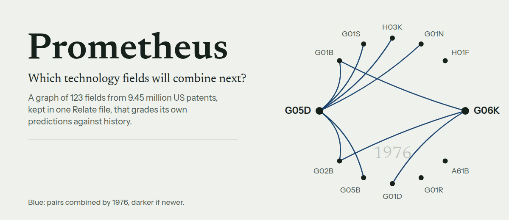
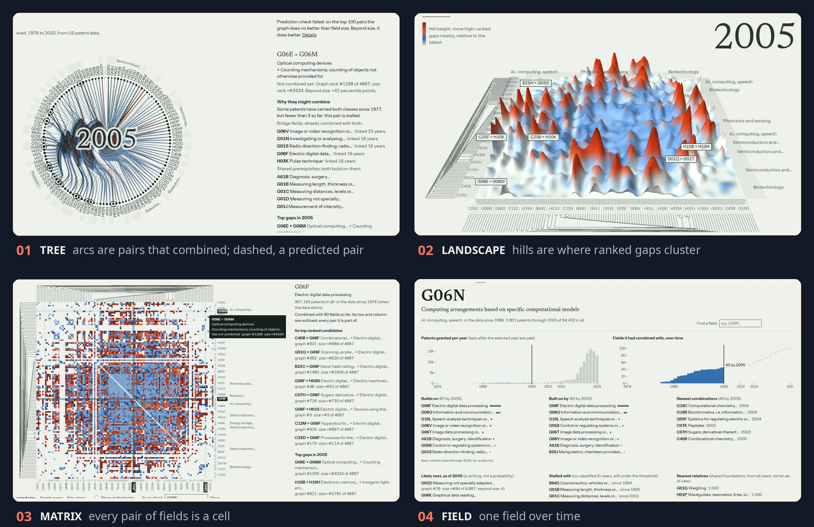
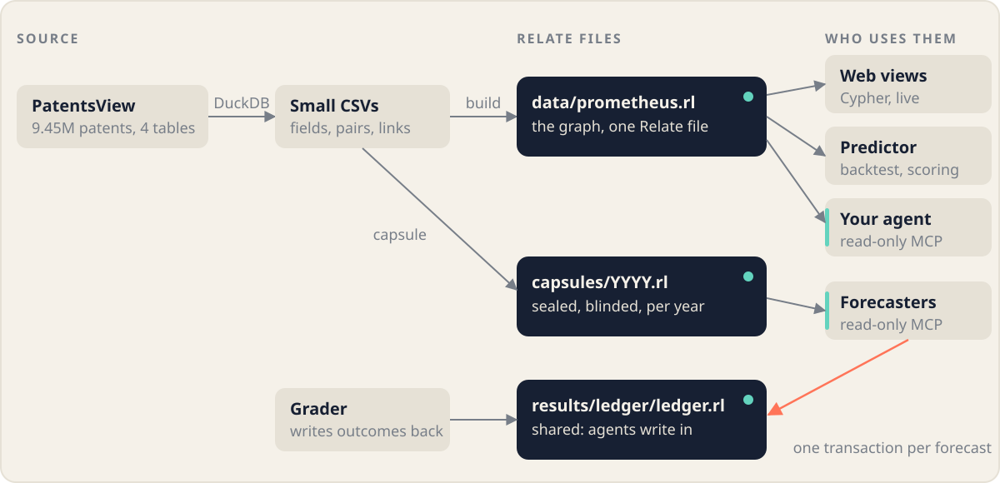
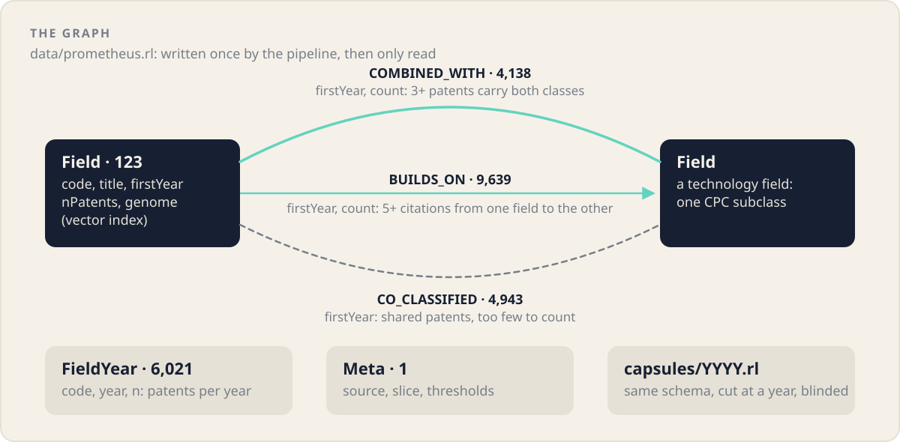
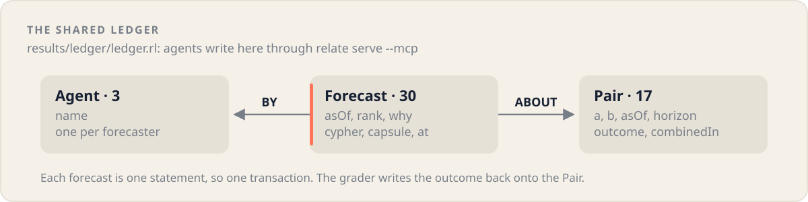
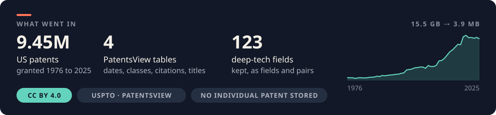
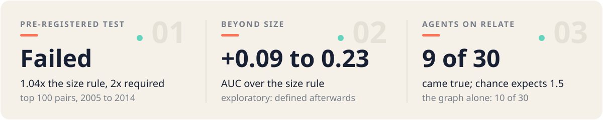
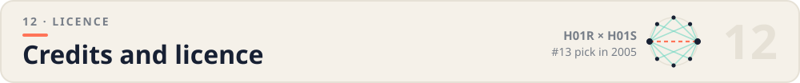

<picture>
  <source media="(prefers-reduced-motion: reduce)" srcset="assets/readme/hero.png">
  
</picture>

Which technology fields will combine next, and can a graph predict it better than "big fields combine with big fields"?
Prometheus builds a graph of 123 technology fields from 9.45 million US patents, keeps it in one [Relate](https://relatedb.ai) file,
and grades its own predictions against what actually happened. Built for the Relate by Neo4j hackathon.

**▶ [Watch the 90-second demo](https://youtu.be/bhWl4FfIp-s)**



<a id="use-case"></a>


New technology often appears where two existing fields meet. People who plan research or follow innovation want to know which pairs are
about to combine, but such claims are rarely checked against history, and many "predictions" turn out to be a measure of size.
Prometheus lets a person, or an agent, see which pairs of fields may combine next, see the evidence for each pair, and check every
ranking against the ten years that followed.

The relationships that matter, each stamped with the year it first appeared:

- **`COMBINED_WITH`**: at least three patents carry both fields' classes. This is what is predicted.
- **`BUILDS_ON`**: one field's patents cite the other's. Fields that build on the same things are close.
- **Shared partners and shared prerequisites**: two fields that have not combined, but already connect to the same fields. This is the evidence for a pair.
- **`CO_CLASSIFIED`**: some patents carry both classes, but too few to count. These pairs are stalled, not absent.

<a id="how-it-uses-relate"></a>




- **Mode: single file.** The graph is `data/prometheus.rl` (3.9 MB), plus one sealed `.rl` file per year in `capsules/`.
- **Why this mode:** the graph is written once by a pipeline and then only read. One file ships in the repo, opens with the Relate CLI or
  Python package with no server, and a sealed capsule is naturally one file per moment in time.
- **What Relate does here:**
  - **Time travel:** "the graph as of 1995" is a Cypher filter on `firstYear`, not a copy.
  - **Evidence:** every page asks Relate live for bridge fields, shared prerequisites, ancestry and knock-out effects.
  - **Vector search:** nearest relatives come from a vector index on the genome.
  - **Shared state for agents:** several agents write their forecasts into one ledger (`results/ledger/ledger.rl`) through a single
    `relate serve --mcp` server, each in one statement that Relate runs as one transaction; the grader writes the outcomes back into the same file.
    It tests shared writes, not forecasting: with no rule against easy big-field pairs, 28 of the 30 picks combined. The forecast result
    is the blinded test's 9 of 30 in [docs/RESULTS.md](docs/RESULTS.md). See [results/ledger/REPORT.md](results/ledger/REPORT.md).
  - **Agents:** a sealed capsule is served with `relate serve --mcp stdio --read-only`. A forecaster agent gets only `get_schema` and
    `read_cypher`, and writes are refused.
- **What it does not do:** the one-off reduction of the raw patent tables runs in DuckDB, and the scoring math runs in Python over snapshots
  read from Relate (a test checks the Cypher and Python scorers agree). See [docs/ARCHITECTURE.md](docs/ARCHITECTURE.md).

<a id="relate-schema"></a>


Two Relate files, two schemas. The graph holds technology fields and the links between them, each stamped with the year it first appeared:



The shared ledger is where agents write their forecasts and the grader writes back what happened:



<details>
<summary>The schema as text</summary>

```
// data/prometheus.rl  (capsules/YYYY.rl: the same, cut at their year, blinded)
(:Field {code, title, firstYear, nPatents, genome})       // genome has a vector index
(:Field)-[:COMBINED_WITH {firstYear, count}]->(:Field)     // 3+ patents carry both classes; stored a < b
(:Field)-[:BUILDS_ON {firstYear, count}]->(:Field)         // 5+ citations from one field's patents to the other's
(:Field)-[:CO_CLASSIFIED {firstYear}]->(:Field)            // some shared patents, too few to count
(:FieldYear {code, year, n})                               // patents of a field granted in one year
(:Meta {source, slice, dataEndYear, minPairPatents, ...})  // how the store was made, thresholds included

// results/ledger/ledger.rl
(:Forecast {asOf, rank, why, cypher, capsule, at})-[:BY]->(:Agent {name})
(:Forecast)-[:ABOUT]->(:Pair {a, b, asOf, horizon, outcome, combinedIn})
```

</details>

<a id="setup-and-run"></a>


Prerequisites: Python 3.10 or newer. Optional, for the agent experiments: the Relate CLI (`curl -sSfL https://relatedb.ai/install.sh | bash`).

```bash
git clone https://github.com/Rishikoli/prometheus && cd prometheus
python3 -m venv .venv && source .venv/bin/activate
pip install -e ".[dev]"

make demo     # synthetic data, a few seconds: builds a store, runs the backtest, grades a sealed-capsule forecast
make test     # 67 tests

prometheus serve data/prometheus.rl --weights-from results/backtest.json --open    # the real graph at http://127.0.0.1:8765/
```

The graph from the command line:

```bash
prometheus info data/prometheus.rl                               # what is in the store
prometheus gaps data/prometheus.rl --as-of 2005 --top 10         # pairs ranked most likely to combine next, as of 2005
prometheus evidence data/prometheus.rl G06E G06M --as-of 2005    # why: bridge fields and shared prerequisites
```

To rebuild everything from the raw patent data, see [docs/GUIDE.md](docs/GUIDE.md) and [docs/DATA.md](docs/DATA.md).
The Relate CLI collects anonymous usage metrics by default; `relate telemetry off` turns that off.

<a id="dataset"></a>




- **Source:** [PatentsView](https://patentsview.org) granted-patent tables from the USPTO, hosted on the [USPTO Open Data Portal](https://data.uspto.gov/bulkdata/datasets/pvgpatdis): `g_patent`, `g_cpc_current`, `g_us_patent_citation` and `g_cpc_title`.
- **What we keep:** 123 CPC subclasses in AI and computing, semiconductors, biotech, medical devices, energy, robotics, photonics and sensing, aggregated to fields and pairs of fields.
- **Licence:** [CC BY 4.0](https://creativecommons.org/licenses/by/4.0/), credited as "Source: PatentsView (www.patentsview.org)". Check the current terms on the portal before reusing the data.
- **Reproduce:** file names, sizes and column names are in [docs/DATA.md](docs/DATA.md).

<a id="where-the-data-lives"></a>


| Path | What it holds |
|---|---|
| `data/prometheus.rl` | the graph: real PatentsView data, 123 fields, 4,138 combined pairs, 9,639 dependencies |
| `capsules/*.rl` | sealed, blinded stores for 1995, 2005, 2010, 2015 and 2020, used by the forecaster agents |
| `results/ledger/ledger.rl` | the shared forecast ledger: three agents' picks, reasons, Cypher and graded outcomes |
| `data/csv/` | the small CSVs the store is built from |
| `results/` | the backtest, the analyses, the agents' prompts, forecasts and grades |

<a id="what-we-found"></a>




- **The pre-registered test failed.** The graph's top 100 predictions beat the size rule by 1.04 times, against the 2 times we required
  in advance (NO-GO). It does predict (AUC about 0.84 against 0.5 for random), but at the top of the ranking big fields combining with big
  fields leaves almost no room above the size rule.
- **Beyond size, the graph adds real information.** On the pairs the size rule ranks low, the graph beats it by 0.09 to 0.23 AUC, and that
  holds with a second size measure and on a narrower set of fields. These analyses were defined after the failure, so they are exploratory.
- **Agents can do it through Relate.** Fresh agents using only Relate's read-only MCP tools on a sealed, blinded capsule picked 9 of 30 pairs
  that went on to combine, where chance predicts 1.5, about the same as the graph predictor.

Small samples, a 1976 start that hides field ages, and other caveats are in [docs/RESULTS.md](docs/RESULTS.md).

<a id="the-views"></a>


`prometheus serve` opens a local page with three views of the same graph, plus a page per field:

- **Tree** (front page): the fields around a circle, grouped by shared foundations, with arcs for combinations.
- **Matrix:** every pair of fields as a cell.
- **Landscape:** the matrix as 3D terrain.
- **Field profile:** one field at a time: its patents and partners over time, what it builds on, its likely next pairs, stalled pairs and what breaks without it.

Each view has a year slider, the evidence for any pair, and the prediction check. Details are in [docs/GUIDE.md](docs/GUIDE.md).

<a id="ask-the-graph-with-your-own-agent"></a>


Any MCP-capable agent can query the real graph, read-only, through Relate's own server:

```bash
prometheus agent-config data/prometheus.rl --out agent/mcp.json   # needs the Relate CLI; writes absolute paths for your clone
claude --mcp-config agent/mcp.json                                 # or add the server to Claude Desktop or another MCP client
```

Then give the agent [agent/PROMPT.md](agent/PROMPT.md): the schema, the rules for answering "as of" a year, and twelve Cypher recipes, each checked
against the store with `python scripts/mcp_query.py data/prometheus.rl --check agent/PROMPT.md`.
An example, with the agent's exact answer and queries: [results/agent_ask/G06E_G06M.md](results/agent_ask/G06E_G06M.md).

<a id="beat-the-graph"></a>


A forecast challenge on the sealed capsules: pick 10 pairs that will combine, but not the easy big-field pairs, and get scored next to the graph,
the size rule and chance on exactly the same pairs. The graph scored 2, 4 and 4 of 10 in the three rounds; chance expects less than one.

```bash
prometheus challenge brief --round 2005
prometheus challenge score my_forecast.json --round 2005
```

Rules, the leaderboard and fair play: [challenge/README.md](challenge/README.md).

<a id="documentation"></a>


| File | Contents |
|---|---|
| [docs/RESULTS.md](docs/RESULTS.md) | the results in short: the backtest, beyond size, agents on Relate, limitations |
| [docs/GUIDE.md](docs/GUIDE.md) | rebuilding from raw data, all commands, the views in detail, slices, the agent experiments |
| [docs/ARCHITECTURE.md](docs/ARCHITECTURE.md) | how the parts fit, what runs on Relate, the no-peeking rules |
| [docs/DATA.md](docs/DATA.md) | where the data comes from, file sizes and columns |

<a id="credits-and-licence"></a>


Patent data: Source: PatentsView (www.patentsview.org), USPTO, used under CC BY 4.0. The derived graph in this repository is aggregated from it.
Code under the MIT licence, see [LICENSE](LICENSE).
