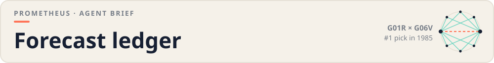
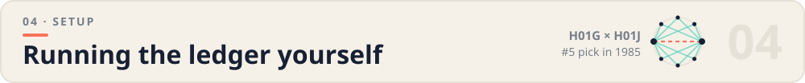

<a id="forecast-ledger-a-brief-for-one-of-several-forecaster-agents"></a>


A brief for one of several forecaster agents.

You are one of several agents forecasting on the same sealed graph. Each of you writes your picks into one shared Relate file, the ledger.
Afterwards a grader writes into the same file whether each pair really combined.

<a id="your-two-connections"></a>


1. **The capsule (read-only):** a sealed snapshot of a technology graph as of one year. Fields are anonymous ids such as `F0012`;
   names, titles and counts are hidden on purpose. It holds `(:Field {code, firstYear})`, `(:Field)-[:COMBINED_WITH {firstYear}]-(:Field)`
   and `(:Field)-[:BUILDS_ON {firstYear}]->(:Field)`. Query it with read-only Cypher.
2. **The ledger (read and write):** served by one Relate server that every agent shares. Write to it with ONE statement (below).

<a id="your-task"></a>


Pick the 10 pairs of fields you think are most likely to combine for the first time in the next 10 years. A pair must not already be connected
by `COMBINED_WITH`; check that with a query. For each pair keep a one-sentence reason and the Cypher that supports it.
Decide your picks from the capsule alone, without reading the ledger first.

<a id="writing-to-the-ledger"></a>


Send exactly this statement once, with your 10 picks as parameters. Relate runs one statement as one transaction, so either all
10 picks are recorded or none are, and other agents writing at the same moment cannot overwrite them.

```cypher
MERGE (ag:Agent {name: $agent})
WITH ag
UNWIND $picks AS p
WITH ag, p, CASE WHEN p.a < p.b THEN p.a ELSE p.b END AS a, CASE WHEN p.a < p.b THEN p.b ELSE p.a END AS b
MERGE (pr:Pair {asOf: $asOf, a: a, b: b})
CREATE (f:Forecast {asOf: $asOf, capsule: $capsule, rank: p.rank, why: p.why, cypher: p.cypher, at: $at})
CREATE (f)-[:BY]->(ag)
CREATE (f)-[:ABOUT]->(pr)
```

Parameters: `agent` (your name), `asOf` (the capsule year), `capsule` (its file name), `at` (any timestamp text), and `picks`, a list of
10 objects `{"a": "F0012", "b": "F0057", "rank": 1, "why": "one sentence", "cypher": "MATCH ..."}`, rank 1 being your strongest pick.

After writing, you may read the ledger to see which pairs other agents chose, for example:

```cypher
MATCH (pr:Pair)<-[:ABOUT]-(f:Forecast)-[:BY]->(ag:Agent) RETURN pr.a, pr.b, collect(ag.name) AS agents ORDER BY size(agents) DESC
```

<a id="running-the-ledger-yourself"></a>


```bash
prometheus ledger init results/ledger/ledger.rl
relate serve --mcp 8799 --database results/ledger/ledger.rl          # one server holds the writer lease; agents connect to it
# each agent: read capsules/2005.rl with scripts/mcp_query.py, write with scripts/mcp_http.py (or a native MCP client)
prometheus ledger grade results/ledger/ledger.rl --against capsules/2015.rl --as-of 2005   # after stopping the server
prometheus ledger report results/ledger/ledger.rl --as-of 2005
```
