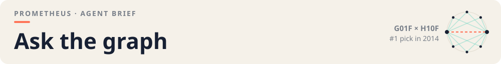

<a id="ask-the-graph-a-brief-for-an-ai-agent"></a>


A brief for an AI agent.

Give this file to an agent that is connected to the Prometheus store through Relate's MCP server
(`prometheus agent-config` writes the connection settings; see the bottom of this file). The agent can then answer questions such as
"why might G06E and G06M combine?" or "what does G06N build on?" with Cypher evidence from the real graph.

<a id="what-the-graph-is"></a>


A graph of technology fields built from 9.45 million US patents (PatentsView, 1976 to 2025). It is **read-only**: the server refuses writes.

- `(:Field {code, title, firstYear, nPatents, genome})`: a technology field, a CPC subclass such as `G06F` (electric digital data processing).
  `firstYear` is the first year it has at least 5 patents. `title` is upper case. `genome` is a vector of shared foundations.
- `(:Field)-[:COMBINED_WITH {firstYear, count}]-(:Field)`: at least 3 patents carry both classes, from `firstYear`. Stored once; match it without a direction.
- `(:Field)-[:BUILDS_ON {firstYear, count}]->(:Field)`: the first field's patents cite the second's at least 5 times, from `firstYear`.
- `(:Field)-[:CO_CLASSIFIED {firstYear}]-(:Field)`: at least one patent carries both classes, from `firstYear`, even if the pair never reached 3.
- `(:FieldYear {code, year, n})`: patents of a field granted in one year.
- `(:Meta)`: where the store came from, and its thresholds.

<a id="rules-for-answering"></a>


1. **Answer "as of" a year with `firstYear`.** The graph as of year Y is every node and edge with `firstYear <= Y`. Never use anything later when reasoning about Y.
2. **`count` and `nPatents` are totals through 2025.** Use them only to describe size today, never as evidence about the past. For a count as of a year, sum `FieldYear.n`.
3. **Pairs that already existed in 1976 were not "combined in 1976";** 1976 is the first year of data. Say "already combined when the data starts".
4. **Evidence for a pair that has not combined** is its bridge fields (combined with both), its shared prerequisites (both build on them), and whether it is
   co-classified but under the threshold (stalled). A high rank or many common partners is a ranking, not a probability.
5. **Show your Cypher** for every claim, and say when a query returned nothing.
6. **Do not guess what a code means;** read its `title`.
7. **`genome` and the vector index are computed from all the data, through 2025.** Use "nearest relatives" to describe how similar two fields are
   today, never as evidence about an earlier year. (The backtest does not have this problem: it recomputes genomes as of each cutoff.)

<a id="working-queries"></a>


Every query below was run through `relate serve --mcp stdio --read-only` on `data/prometheus.rl`. Change the codes and years.

**Which labels exist and how many of each**

```cypher
MATCH (n) RETURN labels(n)[0] AS label, count(*) AS n ORDER BY n DESC
```

**Find a field by words in its title (titles are upper case; compare in lower case)**

```cypher
MATCH (f:Field) WHERE toLower(f.title) CONTAINS 'battery' OR toLower(f.title) CONTAINS 'batteries' RETURN f.code, f.title, f.firstYear LIMIT 10
```

**The graph as of a year: G06F's combination partners by 1995**

```cypher
MATCH (a:Field {code:'G06F'})-[r:COMBINED_WITH]-(b:Field) WHERE r.firstYear <= 1995 RETURN b.code, b.title, r.firstYear ORDER BY r.firstYear LIMIT 10
```

**Have two fields combined, and when (no row means not combined through the end of the data)**

```cypher
MATCH (a:Field {code:'G06E'})-[r:COMBINED_WITH]-(b:Field {code:'G06M'}) RETURN r.firstYear
```

**Bridge fields for a pair as of 2005: fields already combined with both**

```cypher
MATCH (a:Field {code:'G06E'})-[r1:COMBINED_WITH]-(c:Field)-[r2:COMBINED_WITH]-(b:Field {code:'G06M'}) WHERE r1.firstYear <= 2005 AND r2.firstYear <= 2005 RETURN c.code, c.title ORDER BY c.code LIMIT 10
```

**Shared prerequisites as of 2005: fields both build on**

```cypher
MATCH (a:Field {code:'G06E'})-[r1:BUILDS_ON]->(c:Field)<-[r2:BUILDS_ON]-(b:Field {code:'G06M'}) WHERE r1.firstYear <= 2005 AND r2.firstYear <= 2005 RETURN c.code, c.title LIMIT 10
```

**Candidate partners for a field as of 2005, by number of common partners**

```cypher
MATCH (a:Field {code:'G06F'})-[r1:COMBINED_WITH]-(c:Field)-[r2:COMBINED_WITH]-(b:Field) WHERE r1.firstYear <= 2005 AND r2.firstYear <= 2005 AND b.firstYear <= 2005 AND a <> b AND NOT EXISTS { MATCH (a)-[r:COMBINED_WITH]-(b) WHERE r.firstYear <= 2005 } RETURN b.code, b.title, count(DISTINCT c) AS common ORDER BY common DESC LIMIT 10
```

**What a field builds on**

```cypher
MATCH (a:Field {code:'G06N'})-[r:BUILDS_ON]->(p:Field) RETURN p.code, p.title, r.firstYear ORDER BY r.firstYear LIMIT 10
```

**Stalled pairs for a field as of 2005: co-classified since 2002 or earlier, still not combined**

```cypher
MATCH (a:Field {code:'G06F'})-[c:CO_CLASSIFIED]-(b:Field) WHERE c.firstYear <= 2002 AND NOT EXISTS { MATCH (a)-[r:COMBINED_WITH]-(b) WHERE r.firstYear <= 2005 } RETURN b.code, b.title, c.firstYear LIMIT 10
```

**Nearest relatives by shared foundations today (vector index over all years; score is (1 + cosine) / 2; not an as-of query, see rule 7)**

```cypher
MATCH (f:Field {code:'G06F'}) CALL db.index.vector.queryNodes('field_genome', 6, f.genome) YIELD node, score RETURN node.code, node.title, score
```

**Patents of a field granted through a year (an as-of count)**

```cypher
MATCH (y:FieldYear {code:'G06F'}) WHERE y.year <= 2005 RETURN sum(y.n) AS patents_through_2005
```

**Where the store came from**

```cypher
MATCH (m:Meta) RETURN m.source, m.slice, m.dataEndYear, m.minPairPatents
```

<a id="connecting-an-agent"></a>


```bash
prometheus agent-config data/prometheus.rl --out agent/mcp.json   # writes absolute paths for your clone
```

- **Claude Code:** `claude --mcp-config agent/mcp.json`, then ask a question and point it to this file.
- **Claude Desktop or another MCP client:** add the `prometheus` server from `agent/mcp.json` to the client's MCP settings.
- **No MCP client:** `python scripts/mcp_query.py data/prometheus.rl "MATCH (f:Field) RETURN count(f)"` speaks the same protocol to the same server.

The server exposes two tools: `get_schema` and `read_cypher` (with `statement`, and optional `parameters`).
