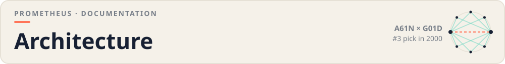

<a id="architecture"></a>


PROMETHEUS turns patent data into a small graph of technology fields, keeps it in one Relate file, and uses that graph three ways: to rank
which pairs of fields may combine next, to grade that ranking against history, and to let people and agents inspect the evidence.

<a id="1-the-whole-picture"></a>


```mermaid
flowchart LR
  subgraph prep["Preparation (DuckDB, runs once)"]
    raw["PatentsView TSVs<br/>9.45M patents"] --> pipe["pipeline.py<br/>aggregate to fields and pairs"]
    pipe --> csv["small CSVs"]
  end
  csv --> build["build.py"]
  subgraph relate["Relate (single .rl files)"]
    store[("data/prometheus.rl<br/>the graph")]
    caps[("capsules/YYYY.rl<br/>sealed, one per year")]
  end
  build --> store
  csv --> capsule["capsule.py"] --> caps
  store --> graph["graph.py<br/>Cypher, read-only"]
  graph --> predict["predict.py<br/>scoring"]
  predict --> backtest["backtest.py / beyond.py<br/>grading"]
  graph --> server["server.py"] --> pages["web pages"]
  caps --> mcp["relate serve --mcp"] --> agent["forecaster agent"] --> grade["grade.py"]
```

<a id="2-what-runs-where"></a>


| Layer | Does | Does not do |
|---|---|---|
| **DuckDB** (`pipeline.py`) | the one heavy step: 9.45M patents and 10.9 GB of citations reduced to a few thousand rows | anything after the CSVs |
| **Relate** (`build.py`, `graph.py`, `capsule.py`, `ledger.py`) | the single-file store, every query (as-of filters, evidence, ancestry, knock-out), the vector index, the MCP interface for agents and the shared ledger | the heavy crunch and the scoring math |
| **Python** (`predict.py`, `backtest.py`, `beyond.py`, `grade.py`) | pulls snapshots from Relate with Cypher, then scores in memory | writing to the store after the build |
| **Browser** | draws what the server returns, fully offline | any computation that decides a result |

A test checks that the Cypher common-neighbours query and the Python scorer agree on every pair.

<a id="3-the-data-model"></a>


```
(:Field {code, title, firstYear, nPatents, genome})            a CPC subclass; genome has a vector index
(:Field)-[:COMBINED_WITH {firstYear, count}]->(:Field)          3+ patents carry both classes
(:Field)-[:BUILDS_ON     {firstYear, count}]->(:Field)          5+ citations from one field to the other
(:Field)-[:CO_CLASSIFIED {firstYear}]->(:Field)                 some patents carry both, too few to count
(:FieldYear {code, year, n})                                    patents of a field granted in one year
(:Meta {source, dataEndYear, slice, thresholds, asOf, blind})   how this store was made
```

All thresholds live in `config.py` and are written into `Meta`.

<a id="4-nothing-from-the-future"></a>


The invariant everything else protects.

A prediction made as of year Y must not see anything after Y:

- **Time travel is a filter:** "the graph as of Y" is `WHERE r.firstYear <= Y`, never a copy.
- **Totals never enter a feature:** end-of-data counts are display-only; size proxies sum `FieldYear` rows up to the cutoff.
- **Capsules are blind:** only edges up to their year, opaque ids (`F0070`), no titles, no counts.
- **Weights are frozen:** tuned on 1990 to 2000 only; results that count are on 2005, 2010 and 2014.
- **Tested:** no-peeking checks, capsule sealing, and a placebo that must find nothing.

<a id="5-the-agent-path"></a>


%%{init: {
  "theme": "base",
  "themeVariables": {
    "background": "#F5F1E9",
    "primaryColor": "#F5F1E9",
    "primaryTextColor": "#172033",
    "primaryBorderColor": "#E6E1D6",
    "lineColor": "#63D3BE",
    "secondaryColor": "#E6E1D6",
    "tertiaryColor": "#F5F1E9",
    "actorBkg": "#F5F1E9",
    "actorBorder": "#172033",
    "actorTextColor": "#172033",
    "actorLineColor": "#63D3BE",
    "signalColor": "#FF7458",
    "signalTextColor": "#172033",
    "labelBoxBkgColor": "#E6E1D6",
    "labelBoxBorderColor": "#E6E1D6",
    "labelTextColor": "#172033",
    "loopTextColor": "#172033",
    "noteBkgColor": "#E6E1D6",
    "noteBorderColor": "#E6E1D6",
    "noteTextColor": "#172033",
    "activationBkgColor": "#63D3BE",
    "activationBorderColor": "#172033",
    "sequenceNumberColor": "#F5F1E9"
  }
}}%%

sequenceDiagram
    participant C as capsule.py
    participant R as relate serve --mcp (read-only)
    participant A as forecaster agent
    participant G as grade.py

    C->>R: capsules/1995.rl (blind, sealed)
    A->>R: get_schema
    A->>R: read_cypher (MATCH only, writes refused)
    R-->>A: rows as JSON
    A->>G: forecast.json with 10 pairs, each with its Cypher
    G->>G: compare with the capsule ten years later

The agent sees two tools and an anonymous graph. Every pick must carry the Cypher behind it, and the grader rejects pairs that are unknown
or already combined. `prometheus agent-config` gives any MCP client the same read-only access to the full store, briefed by [agent/PROMPT.md](../agent/PROMPT.md).

<a id="6-the-web-server"></a>


`prometheus serve STORE` opens the store read-only and serves the pages plus a JSON API (`/api/state`, `/api/tree`, `/api/evidence`,
`/api/field`, `/api/check`). It binds to 127.0.0.1, has no write route, and is single-threaded because a Relate connection belongs to
the thread that opened it. Design choices are in [DESIGN.md](DESIGN.md).

<a id="7-trade-offs"></a>


- Most fields are dated 1976, the first year of data, so field ages are unreliable.
- The heavy preparation is DuckDB and the scoring is Python, by design; Relate is the store, the query layer, the vector index and the agent interface.
- The server is local and single-user: a research tool, not a service.
