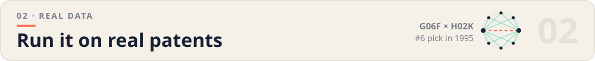
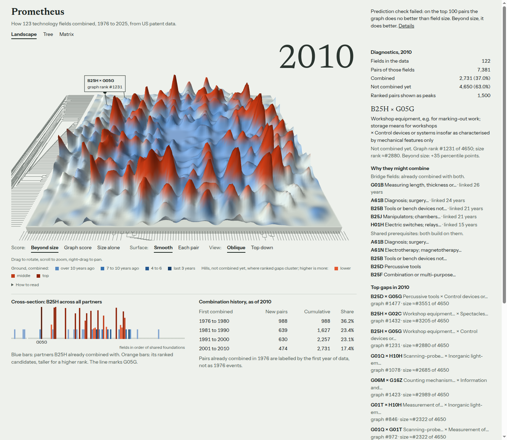
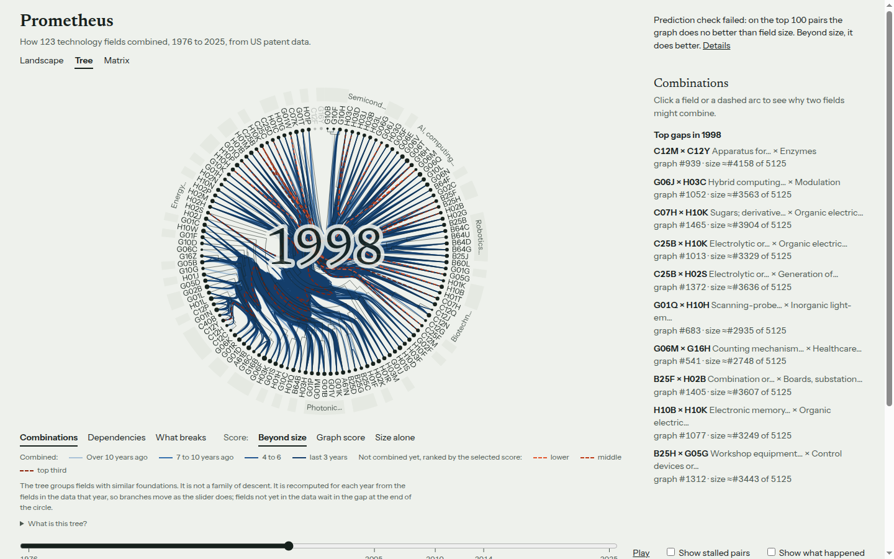
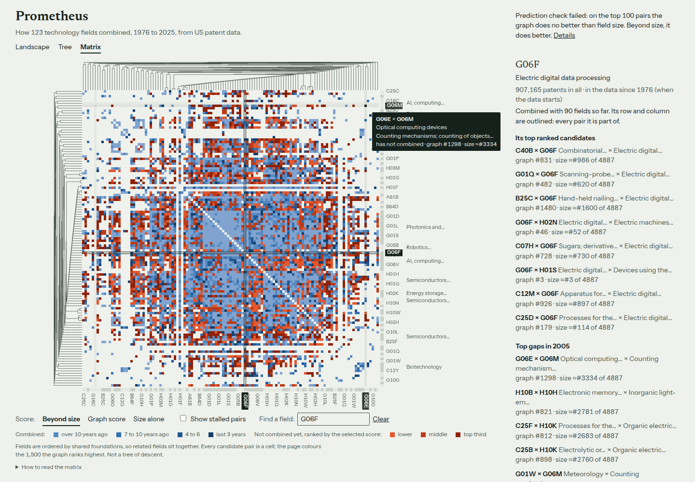

<a id="guide"></a>


How to rebuild the graph from the raw data, every command, the three views in detail, the field slices and the sealed-capsule experiments.
For the design of the code see [ARCHITECTURE.md](ARCHITECTURE.md); for the results see [RESULTS.md](RESULTS.md).

<a id="use-case-in-more-detail"></a>


**The problem.** New technology often arrives where two existing fields meet: batteries and software, imaging and machine learning. People who plan research
or follow innovation (R&D strategists, funders, analysts) would like to know which pairs of fields are about to combine. Anyone can claim to see it; very
few check the claim against history. And there is a cheap rival that is easy to forget: **big fields tend to combine with other big fields**, so a "prediction"
may only be a measure of size. This project builds the graph that lets you ask the question properly, and grades the answer against what actually happened.

**Which relationships matter.** Everything is a relationship between technology fields (patent classes), and each one carries the year it first appeared:

| Relationship | Meaning | Why it matters |
|---|---|---|
| `COMBINED_WITH` | enough patents carry both classes | the thing being predicted; its history is the training signal |
| `BUILDS_ON` | one field's patents cite the other's | a field's prerequisites; fields with shared foundations are close |
| shared partners and shared prerequisites | two fields that have not combined yet, but already connect to the same fields | the evidence for a candidate pair, shown on every page as "bridge fields" and "shared prerequisites" |
| `CO_CLASSIFIED` | some patents carry both classes, below the combination threshold | pairs that are stalled, not absent |
| time (`firstYear` on every edge) | when a relationship appeared | the graph "as of" any year is a query, so every prediction can be tested on what came after |

**Who it is for.** A person exploring the graph (a tree, a matrix and a 3D landscape, each with the evidence behind a pair), and an agent that has to reason over it:
the forecaster experiments give a language model only a sealed, blinded, read-only Relate file for one year and score its ten picks against the next ten years.

**What we found.** Not what we hoped. On the question we declared in advance, the graph's predictions do **not** beat the size rule (a clear NO-GO). Where we looked beyond
size, afterwards and labelled as exploratory, the graph does carry real information. The honest answer to "which fields will combine next?" is therefore
"big ones, mostly; the graph adds something real among the rest". See [Where the graph adds most](RESULTS.md#where-the-graph-adds-most).

It is a way to examine a claim, not a forecast to invest on: a high rank is a ranking, not a probability.

<a id="run-it-on-real-patents"></a>


1. Download the PatentsView tables listed in [docs/DATA.md](DATA.md) (several GB; the page has moved, see the note there).
2. Build the small field-level files, then the store:

```bash
prometheus pipeline --patent data/raw/g_patent.tsv --cpc data/raw/g_cpc_current.tsv \
                  --cites data/raw/g_us_patent_citation.tsv --titles data/raw/g_cpc_title.tsv \
                  --out data/csv --slice deeptech --memory-limit 8GB --temp-dir /path/with/free/disk
prometheus build data/csv data/prometheus.rl
prometheus genome data/prometheus.rl
prometheus backtest data/prometheus.rl --out results
```

The pipeline also writes `co_assigned.csv` (the first year a patent carried both classes of a pair, for the stalled-pair overlay) and `field_year.csv` (patents per field per year, for the patent-count size proxy). The pipeline reads column names from the file headers. If one differs from what is expected, it stops and prints the
columns it found.

<a id="the-commands"></a>


```
prometheus toy | pipeline | build | info          make or load data
prometheus gaps STORE --as-of 2000                top predicted combinations as of a year
prometheus evidence STORE A B --as-of 2000        bridge fields and shared prerequisites for a pair
prometheus ancestors | descendants STORE CODE     what a field builds on / what builds on it
prometheus knockout STORE CODE [--as-of Y]        dependency exposure if a field were removed
prometheus breakthrough STORE A B --as-of Y       what the model would score if a pair combined (read-only)
prometheus backtest STORE                         grade the predictor, write results/backtest.md
prometheus genome | relatives | order             genome vectors, nearest relatives, dendrogram order
prometheus capsule | baseline-forecast | grade    sealed capsules and grading
prometheus serve STORE                            local read-only web page: heatmap, year slider, evidence
prometheus beyond STORE --weights-from F          A2: AUC on pairs preferential attachment ranks in the bottom half
prometheus pa-threshold CAPSULE [--write-brief F]  A4: eligibility threshold (and brief) for a capsule
```

<a id="explore-it-the-tree-of-life"></a>


```bash
prometheus serve data/prometheus.rl --weights-from results/backtest.json --open     # http://127.0.0.1:8765/
```

A local page (standard-library server, D3 and fonts bundled so it works offline, no build step) over the store, opened
read-only. The 123 fields sit around a circle, grouped by how similar their foundations are (genome clustering of the "builds
on" graph; it is **not** a tree of descent). Pairs that already combined are bundled arcs through the middle, shaded by age at
the slider year, so the picture builds up as the slider moves. Pairs that have not combined but rank high are dashed fire-coloured
arcs; fire means a predicted pair and nothing else. The prediction check, including the failed gate, is always on the page.

| Control | What it does |
|---|---|
| Year slider and Play | the graph as of that year; ticks mark the backtest cutoffs 2005, 2010, 2014. The tree is **recomputed for each year** from the fields in the data that year, each branch flipped to stay near last year's position (consecutive years move a leaf 6 of 123 positions on average); fields not yet in the data wait in a gap at the end of the circle. `#tree=fixed` keeps the single all-data tree |
| Combinations | arcs of combined pairs and the top gaps; click a field or a dashed arc for evidence (bridge fields, shared prerequisites) |
| Dependencies | what the selected field builds on and what builds on it |
| What breaks | leaves shaded by how exposed they are if the selected field disappeared, with the number of citing links behind each |
| Score: Beyond size, Graph score, Size alone | how the gaps are ranked; Beyond size is graph rank minus what field size alone predicts |
| Show what happened | up to 2014: gaps that combined within ten years are solid, the rest hollow grey |
| Newest only | only the pairs combined in the last three years, so each year's new layer stands out (the full history makes years look alike) |
| Find a field | type a code (`G06F`) to select it; the selection carries over to the matrix and landscape |
| Show stalled pairs | grey dotted arcs for pairs where some patents carry both classes, for three years or more, but fewer than the 3-patent combination threshold (about 800 a year). A display overlay: it is not a score and not a prediction |
| Details (top right) | the per-cutoff backtest table and a chart of graph vs size alone, all pairs and beyond-size |

**Landscape view (3D).** The `Landscape` link in the top bar opens `/landscape` (WebGL, Three.js bundled, so it works offline): the matrix as terrain.
Every point on the surface is a pair of fields, in the same genome order as the matrix, with the clustering tree along the front and left
edges. The low ground is pairs that already combined, shaded blue by age; fire-coloured peaks are ranked gaps. Two honest settings:
**Smooth** (default) blurs the surface over about two neighbouring fields, so a hill means many high-ranked gaps among related fields and
heights are relative to the tallest hill that year; **Each pair** draws every ranked pair as its own spike, taller for a higher rank. Drag to
rotate, scroll to zoom, right-drag to pan; hover and click snap to the nearest ranked pair. **Reading it:** field codes run along the two near edges (every sixth field) and domain
names along the two far ones, de-cluttered so they never overlap; the top ranked hills carry labels you can click; hovering a point lights its row and column across the terrain and
marks both fields on the edges; **Find a field** (type `G06F`) draws that field's row and column and shows its own cross-section and top candidates; selecting a pair or a field moves
the camera gently to it; **Oblique, Low angle, Top down** and **Reset** set the view; a small scale in the corner says what height means for the current surface setting. A cross-section panel is a stacked area chart of the selected field
against every other field (smoothed like the surface, or stepped on Each pair): the share of nearby fields it has combined with, by age, and that are ranked candidates, by rank third. It uses true values, not the blur; and a table shows how many pairs first combined in each period up to the slider year. If the
browser has no WebGL the page says so and still lists the numbers and the top gaps. It is a ranking, not a probability, like every other view.



**Matrix view.** The `Matrix` link in the top bar opens `/matrix`, the same year slider, score toggle and evidence panel on a
grid of every field pair, ordered by shared foundations with the clustering tree on two edges and field codes, domain bands and domain names on the other two.
Hovering a cell outlines its row and column and names both fields in the margins; **Find a field** outlines one field's row and column and lists its candidates;
**Show stalled pairs** greys the pairs that are co-classified but under the threshold. Blue cells already combined (darker is
newer); fire cells are the 1,500 pairs the graph ranks highest. The tree shows about 25 arcs; the matrix shows where size and the
graph disagree across all of them, so it carries the beyond-size finding more honestly. `Tree` goes back, keeping the year. The tree stays the front page.

Deep links: `#year=1998`, `#year=2005&stalled=1`, `#tree=fixed`, `#year=2005&gap=1`, `#mode=deps&field=G06F`, `#mode=breaks&field=H01L`, `#year=2005&happened=1&gap=2&details=1`.
Screenshots at 1985, 1998 and 2010 are in `docs/screenshots/`. `python scripts/ui_check.py` drives all three pages in a real browser (91 checks: keyboard, clicks, 3D picking, Play, modes, offline, no-WebGL fallback).





<a id="how-relate-is-used-and-why"></a>


**Storage mode: a single `.rl` file** (`data/prometheus.rl`), plus one small `.rl` per year in `capsules/`. A judge can
open any of them with the Relate CLI or the Python package, no server needed. A single file is the right fit because the
store is written once by a pipeline and then only read; one file is easy to ship, inspect and diff by size, and a capsule
is naturally "one file per moment in time". The persistent data lives in `data/` and `capsules/`.

**What the graph models**

| Element | Properties | Meaning |
|---|---|---|
| `(:Field)` | `code`, `title`, `firstYear`, `nPatents`, `genome` | a CPC subclass; `genome` is a vector with a vector index |
| `[:COMBINED_WITH]` | `firstYear`, `count` | two fields share patents (stored once, queried undirected) |
| `[:BUILDS_ON]` | `firstYear`, `count` | the first field's patents cite the second's |
| `(:Meta)` | `source`, `dataEndYear`, `slice`, thresholds | where this store came from |

`count` is a total through the end of the data. It is for display only: predictors and capsules use existence and
`firstYear`, because a total would leak the future.

**Where Relate does the work**

| Feature | Relate capability | File |
|---|---|---|
| Any snapshot of history | Cypher filter on edge properties | `queries/fields_as_of.cypher` |
| Gaps (adjacent possible) | multi-hop Cypher with a time-aware `NOT EXISTS` | `queries/gaps_common_neighbours.cypher` |
| Bridge fields for a gap | two-hop Cypher | `queries/bridge_fields.cypher` |
| Ancestry | one 1-hop query per level (avoids path explosion) | `queries/ancestors_step.cypher` |
| Knock-out cascade | Cypher aggregation over a parameter map | `queries/knockout_step.cypher` |
| Nearest relatives | vector property and vector index | `prometheus relatives` |
| Sealed capsules | one single-file store per year, served read-only over MCP | `prometheus capsule` |

A test checks that the Cypher common-neighbour query and the in-memory scorer agree on every pair, and every file in
`queries/` is executed by the test suite.

<a id="the-field-slice"></a>


`--slice deeptech` keeps only fields in chosen CPC classes (AI and computing, semiconductors, biotechnology, medical devices,
energy storage and power, robotics, photonics and sensing) and drops the cross-sectional Y tagging classes
(`src/prometheus/slices/deeptech.json`). It is chosen by **class prefix written down in advance**, never by which fields grew
fast, because choosing the winners would leak the answer into the backtest. Check the prefixes against the CPC titles and edit
the file **before** the first backtest. Fields are subclasses, so a topic that lives inside a larger subclass (as far as I
know, quantum computing is one) cannot be isolated. Run the backtest on `--slice all` too and compare.

<a id="sealed-capsules-and-the-forecaster"></a>


```bash
prometheus capsule data/csv --as-of 1995 --out capsules/1995.rl --seed 0
prometheus capsule data/csv --as-of 2005 --out capsules/2005.rl --seed 0
```

A capsule holds only fields and edges with `firstYear` up to its year, with codes and titles replaced by opaque ids
(`F0001`), no counts and no predictions. The id-to-code table is written next to it (`1995.map.json`), never inside it. Ids
are stable across capsules built with the same seed, so a forecast on 1995 can be graded against 2005.

To run a language-model forecaster, install the Relate CLI (`curl -sSfL https://relatedb.ai/install.sh | bash`), add the
generated `capsules/1995.mcp.json` to your MCP client, give the agent `capsules/1995.brief.md`, save its answer as
`forecast.json`, then:

```bash
prometheus grade forecast.json --against capsules/2005.rl --as-of 1995
```

The grader rejects pairs that are unknown or already combined, counts how many forecasts came with their Cypher, and compares the
forecaster with random, preferential attachment and the graph predictor on the same candidate pairs.
**Limits:** blinding reduces hindsight leakage but cannot prove it is zero, because a model might recognise the shape of the
graph; and ten forecasts is a small sample. Treat the agent result as an experiment. The graph predictor has no such leak and is
the headline number. The MCP server (`relate serve --mcp stdio --read-only`) exposes `read_cypher` and `get_schema`, runs MATCH queries and rejects writes ("Only MATCH queries are allowed"). The real-capsule results are in [RESULTS.md](RESULTS.md#agents-reading-relate).

<a id="layout"></a>


How the pieces fit, what runs on Relate and what does not, and the no-peeking rules are in [docs/ARCHITECTURE.md](ARCHITECTURE.md).

```
src/prometheus/   pipeline.py  build.py  graph.py  predict.py  genome.py  backtest.py  beyond.py  capsule.py  grade.py
                  slice.py  server.py  cli.py  config.py  toy.py      (slices/*.json: the CPC slices)
src/prometheus/web/   index.html (tree, the front page)  matrix.html  landscape.html  + bundled D3, Three.js and fonts
queries/          the Cypher behind each feature, one file each, run by the tests
tests/            67 tests (pipeline fixture, Cypher vs Python, no-peeking, placebo, capsule sealing, grading, ledger, CLI, server, A2/A2b)
scripts/          ui_check.py: 91 browser checks across the three pages
data/             prometheus.rl (the real store), narrow.rl, csv/ (the small CSVs); the raw TSVs are git-ignored
capsules/         one sealed, blinded .rl per year for the forecaster experiments
results/          backtest, sensitivity runs, A2/A2b, narrowed slice, forecaster prompts, forecasts and grades
docs/             ARCHITECTURE.md  DATA.md  screenshots/
```

